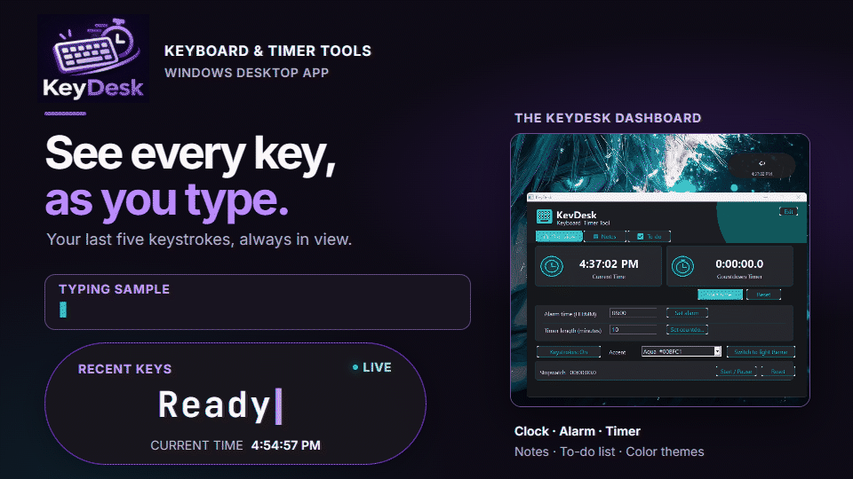

<p align="center">
  
</p>

# KeyDesk

KeyDesk is a small Windows app for showing keystrokes and keeping useful time and productivity tools close by.

## See KeyDesk in action

<p align="center">
  
</p>

The floating panel updates as you type. Click it to open the dashboard with the clock, timer, notes, and to-do list.

## Features

### Floating key display and overview

The floating panel shows recent keystrokes and the current time. Drag it to move it, or click it to open the dashboard. The Overview page includes a clock, alarm, countdown timer, stopwatch, and color themes. Set an alarm using a 12-hour time and AM/PM, then add an optional reminder message. When it is due, KeyDesk shows that message in a non-blocking alert and repeats the bell until dismissed.


### Notes

Create, open, edit, and delete text notes. Notes save automatically.
Select text and press `Ctrl+B` for bold or `Ctrl+I` for italic. Note text remains in `.txt` files; rich-text formatting is stored in hidden app metadata so it can be restored when KeyDesk reopens the note.


### To-do list

Add tasks, update or delete them, and double-click a task to mark it complete or incomplete.


## Build

KeyDesk is written in C++ and uses the Windows desktop interface. To build it, install MinGW-w64 and make sure `g++` is available in your terminal. Then run `build.bat` from the project folder.

You can also build it directly with:

```sh
g++ -std=c++17 -O2 -static -static-libgcc -static-libstdc++ -municode -mwindows KeyDesk.cpp -o KeyDesk.exe -lcomctl32 -lcomdlg32 -lshell32 -lgdi32 -luser32
```

## Use KeyDesk

- Keep KeyDesk running to use the alarm and countdown timer.
- Close the dashboard to return to the floating panel. Use **Exit** to quit the app.
- Use **Keystrokes: On/Off** to show or hide the floating panel.

### Keyboard navigation

- On Overview, `Ctrl+Up` / `Ctrl+Down` moves focus between control rows; `Ctrl+Left` / `Ctrl+Right` moves across controls in the current row.
- On Notes and To-do, `Ctrl+Up` / `Ctrl+Down` moves between dashboard sections. `Ctrl+Left` / `Ctrl+Right` cycles note tabs in Notes and dashboard sections elsewhere.
- `Ctrl+P`: open the searchable Command Palette.
- In Notes, `Ctrl+B` bolds the selected text and `Ctrl+I` italicizes it. These shortcuts act only while the note editor is focused.
- `Esc`: close the palette. Other Windows dialogs and popups handle Escape normally.
- Use the **Keyboard shortcuts** button to search the shortcut reference. Navigation shortcuts are ignored while a text field, task list, or combo box has focus, so editing and normal control navigation keep working.

## Your files and settings

KeyDesk stores notes and to-do items in the `KeyDeskData` folder beside the app. Notes are saved in `KeyDeskData/Notes`, and tasks are saved in `KeyDeskData/ToDo/todos.txt`.

The selected accent theme, light/dark mode, and keystroke visibility are saved in `%APPDATA%\KeyDesk\settings.ini` and restored when KeyDesk starts. Alarm, timer, and stopwatch state is session-only.
