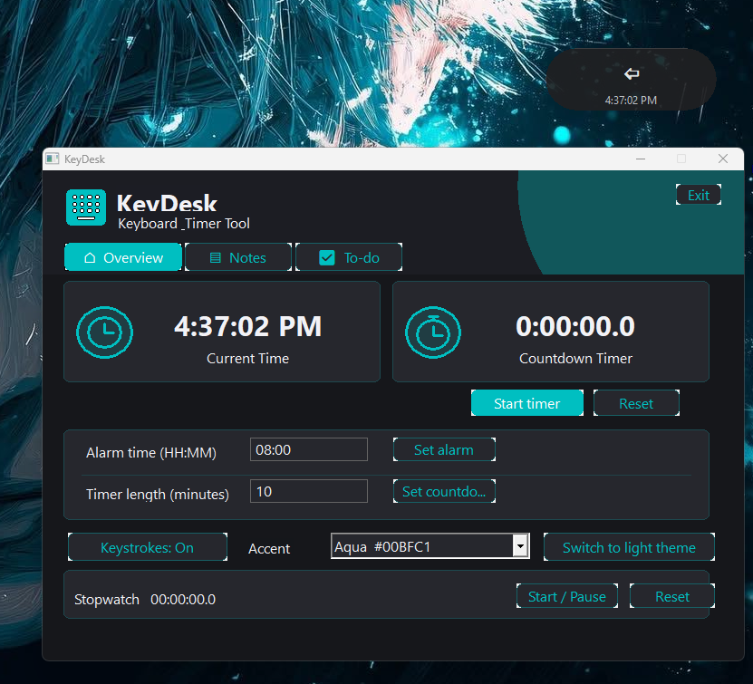
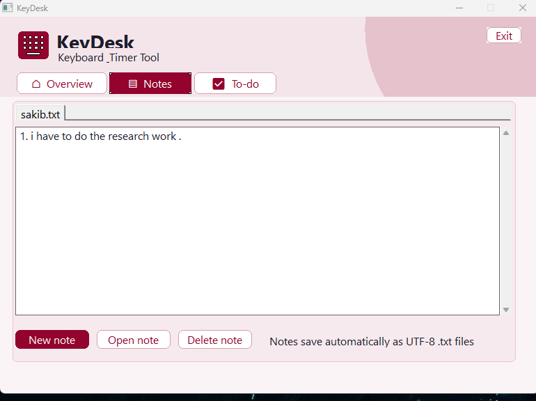
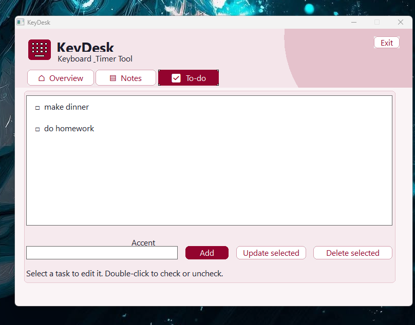

<p align="center">
  
</p>

# KeyDesk

KeyDesk is a small Windows app for showing keystrokes and keeping useful time and productivity tools close by.

## Features

### Floating key display and overview

The floating panel shows recent keystrokes and the current time. Drag it to move it, or click it to open the dashboard. The Overview page includes a clock, alarm, countdown timer, stopwatch, and color themes.



### Notes

Create, open, edit, and delete text notes. Notes save automatically.



### To-do list

Add tasks, update or delete them, and double-click a task to mark it complete or incomplete.



## Build

KeyDesk is written in C++ and uses the Windows desktop interface. To build it, install MinGW-w64 and make sure `g++` is available in your terminal. Then run `build.bat` from the project folder.

You can also build it directly with:

```sh
g++ -std=c++17 -O2 -static -static-libgcc -static-libstdc++ -municode -mwindows KeyDesk.cpp -o KeyDesk.exe -lcomctl32 -lcomdlg32 -lshell32 -lgdi32 -luser32
```

## Use KeyDesk

- Keep KeyDesk running to use the alarm and countdown timer.
- Close the dashboard to return to the floating panel. Use **Exit** to quit the app.
- Use **Keystrokes: On/Off** to show or hide the floating panel.

## Your files and settings

KeyDesk stores notes and to-do items in the `KeyDeskData` folder beside the app. Notes are saved in `KeyDeskData/Notes`, and tasks are saved in `KeyDeskData/ToDo/todos.txt`.

The selected theme, alarm, timer, and stopwatch reset when you close KeyDesk.
